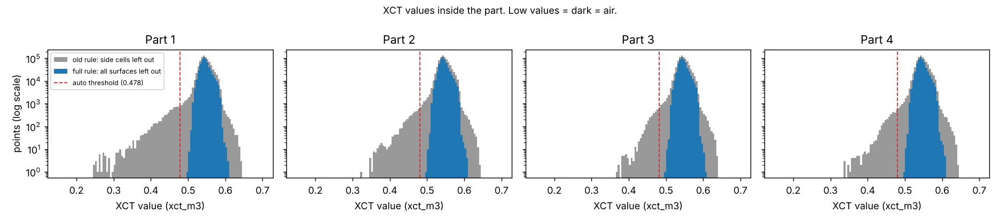

# Anomaly detection in metal additive manufacturing process data

Learn what "normal" looks like in in-situ process monitoring data from metal
3D printing (laser powder bed fusion). Then find, compare and show the places
that are **not** normal, and check them against X-ray CT.


> **Status.** The full run on all four real NIST parts is done (17 November
> 2026): train on parts 1 and 2, set the alarm level on part 3, test on
> part 4. See [Results](#results). The short report is in
> [`docs/report.md`](docs/report.md).

## The question

On a production line, parts are often checked with fixed limits: a value
outside `mean ± k·std` is rejected. That is simple, but it rejects good parts
when "normal" is different in different places of the part.

This project asks: **can a learned model of normal behaviour find real
problems with fewer false rejections than fixed limits?**

## Data

**NIST "Overhang Part X4", fully registered dataset (2025), ID `mds2-3761`.**

- Four nominally identical nickel alloy 625 parts, each 250 layers of 20 µm.
- Each part has a 45° overhang and a round hole. There the laser melts over
  loose powder instead of solid metal, so the process behaves differently.
- A high-speed camera looked at the melt pool through the laser path at
  10 000 frames per second. NIST turned each frame into numbers: melt pool
  length, width and area.
- Every frame is lined up with the laser position, the laser power, the layer
  camera image and the **X-ray CT value** of the finished part at that spot.
- One folder per part, one CSV file per layer, 40 columns, one row per frame.

Column list and open questions: [`docs/data_notes.md`](docs/data_notes.md).

## Method

| Step | What happens | Code |
|---|---|---|
| Load | Read the layer files into one table per part | `src/load.py` |
| Geometry | For every point: how much solid metal is below it? Is it at the surface? | `src/labels.py` |
| Segments | Cut each laser track into pieces of 12 frames (1.2 ms, about 1 mm). A segment is the unit that gets a score. | `src/features.py` |
| Features | Per segment and signal: mean, std, min, max, slope, jitter | `src/features.py` |
| Split | Whole parts go to train / validation / test. Never a random split. | `src/pipeline.py` |
| Labels | (1) injected faults, (2) pores seen by X-ray CT, (3) overhang region | `src/inject.py`, `src/labels.py` |
| Detect | Learn "normal" from normal training segments only, then score the test part | `src/models/` |
| Evaluate | Precision, recall, false rejection rate, PR-AUC, run time | `src/evaluate.py` |
| Show | Layer heatmap, PR curves, signal plots, traceability table | `src/plots.py` |

### Methods compared

| Method | Kind | Idea |
|---|---|---|
| Fixed limits, 3-sigma rule | Rule (baseline) | Flag if any feature is outside mean ± 3 std. No tuning. |
| Fixed limits, tuned k | Rule (baseline) | Same, but k is set on validation data like for the other methods |
| Isolation Forest | Classic ML | Unusual points are easy to separate with random cuts |
| Local Outlier Factor | Classic ML | Unusual points sit in emptier areas than their neighbours |
| One-Class SVM | Classic ML | Draw a tight border around normal data |
| 1D conv. autoencoder | Deep learning | Learn to rebuild normal signal pieces; a bad rebuild = unusual |

### Rules for a fair comparison

- All methods use the same train / validation / test parts.
- Training uses **normal segments only** (segments with an XCT pore are
  removed; in the full NIST run there were none).
- The alarm level of each method is set on the **validation part** so that 1 %
  of normal validation segments are flagged. The test part is never used for
  tuning. A test checks this (`tests/test_pipeline.py`).
- Methods with randomness run with 3 seeds; tables show mean ± std.

### The three kinds of labels

| Label | Meaning | Use |
|---|---|---|
| Injected faults | Spikes, drops, drifts and noise bursts added to normal test signals. Place and size are known exactly. | Main numbers |
| XCT pores | The X-ray CT value at the segment says "pore". Points near any surface of the part are left out (closer than 0.25 mm to a side face, on some faces up to 0.5 mm, or closer than 0.06 mm to a top or bottom face), because there XCT mixes metal and air. | Check against real defects |
| Overhang region | Less than 0.5 mm solid metal below the segment | Shows where false rejections come from. **Not** a defect. |

## Quick start (fake sample data, about 15 seconds)

```bash
git clone https://github.com/dvschandraprasad/am-process-anomaly-detection.git
cd am-process-anomaly-detection
python -m venv .venv && source .venv/bin/activate
pip install -r requirements.txt

pytest -q                                                   # run the tests
python scripts/run_pipeline.py --config configs/sample.yaml # run everything
```

Output goes to `results/sample/`: `results.md` (tables), `figures/`,
`traceability.csv`.

The sample in `data/sample/` is **invented data** with the same file layout
as the NIST files. It only shows that the code runs.

## Run on the real NIST data

```bash
# 1. Download one part first (large file) and look inside
python scripts/download_data.py --parts 1
python scripts/inspect_data.py data/raw/part1

# 2. First run with one part (split by blocks of layers)
python scripts/run_pipeline.py --config configs/nist_x4_one_part.yaml

# 3. Download the rest, look at the XCT values, and do the real run (split by part)
python scripts/download_data.py --parts 2 3 4
python scripts/check_xct.py --config configs/nist_x4.yaml
python scripts/run_pipeline.py --config configs/nist_x4.yaml

# 4. Numbers in the docs that the pipeline does not write (after step 3)
python scripts/extra_numbers.py --config configs/nist_x4.yaml
```

Before step 2, read the output of `inspect_data.py` and check the open points
in [`docs/data_notes.md`](docs/data_notes.md), most of all the XCT pore
threshold.

The NIST zip files unpack one folder deeper (`data/raw/part1/part01/L0001.csv`).
The loader searches all sub-folders, so `data/raw/part1` in the config works.

The full run takes about 3.5 minutes on a machine with 2 CPU cores and needs
about 3 GB of memory. Reading the CSV files the first time adds about
20 seconds; after that a Parquet copy in `data/processed/` is used.

Then look at the data yourself in `notebooks/01_explore.ipynb` and at the
results in `notebooks/02_results.ipynb`.

## Results

**Full run on the real NIST data** (`configs/nist_x4.yaml`, 17 November 2026).

| | |
|---|---|
| Train | parts 1 and 2: 176 756 segments |
| Validation (sets the alarm level) | part 3: 88 378 segments |
| Test | part 4: 88 378 segments |
| Injected faults in the test part | 594 faults, 1 362 faulty segments (1.5 % of test segments) |
| Seeds | 3 for methods with randomness; tables show mean ± std |

The alarm level of every method is set on part 3 so that 1 % of its normal
segments are flagged. Only the 3-sigma rule keeps its fixed level.

### Injected faults (test part 4)

| Method | Precision | Recall | F1 | False rejection rate | PR-AUC | FRR at 90 % recall | Run time [ms/layer] |
|---|---:|---:|---:|---:|---:|---:|---:|
| Fixed limits (3-sigma rule) | 0.118 | 0.789 | 0.206 | 9.2 % | 0.334 | 37.7 % | 0.053 |
| Fixed limits (tuned k) | 0.341 | 0.522 | 0.413 | 1.6 % | 0.334 | 37.7 % | 0.050 |
| Isolation Forest | 0.407 ± 0.005 | 0.519 ± 0.016 | 0.456 ± 0.009 | 1.2 ± 0.0 % | 0.432 ± 0.025 | 36.8 ± 1.3 % | 2.172 ± 0.174 |
| Local Outlier Factor | 0.348 ± 0.005 | 0.686 ± 0.005 | 0.462 ± 0.003 | 2.0 ± 0.1 % | 0.626 ± 0.003 | 30.7 ± 0.2 % | 11.742 ± 0.588 |
| One-Class SVM | 0.391 ± 0.008 | 0.656 ± 0.007 | 0.489 ± 0.005 | 1.6 ± 0.1 % | 0.609 ± 0.006 | 32.5 ± 3.3 % | 2.470 ± 0.125 |
| Conv. autoencoder | 0.304 ± 0.018 | 0.306 ± 0.022 | 0.305 ± 0.020 | 1.1 ± 0.0 % | 0.287 ± 0.018 | 62.7 ± 1.6 % | 0.422 ± 0.049 |

Precision looks low for every method because faulty segments are rare
(1.5 %). A method that guesses at random gets a PR-AUC of about 0.015.
Run time is the time to score the test part, per layer, on 2 CPU cores. It
changes from run to run (by up to about 20 % between three full runs).


**Share of injected faults caught, by kind**

| Method | drift | drop | noise | spike |
|---|---:|---:|---:|---:|
| Fixed limits (3-sigma rule) | 99 % | 100 % | 100 % | 98 % |
| Fixed limits (tuned k) | 68 % | 94 % | 94 % | 67 % |
| Isolation Forest | 36 % | 92 % | 100 % | 90 % |
| Local Outlier Factor | 86 % | 100 % | 100 % | 96 % |
| One-Class SVM | 84 % | 99 % | 100 % | 98 % |
| Conv. autoencoder | 8 % | 30 % | 100 % | 16 % |

**False rejections by region** (normal test segments: 83 626 with solid
metal below, 3 390 in the overhang region)

| Method | Solid metal below | Overhang region |
|---|---:|---:|
| Fixed limits (3-sigma rule) | 9.3 % | 7.4 % |
| Fixed limits (tuned k) | 1.6 % | 1.0 % |
| Isolation Forest | 0.5 ± 0.0 % | 18.8 ± 0.6 % |
| Local Outlier Factor | 1.9 ± 0.1 % | 4.3 ± 0.3 % |
| One-Class SVM | 1.3 ± 0.1 % | 9.1 ± 0.1 % |
| Conv. autoencoder | 1.1 ± 0.0 % | 2.0 ± 0.2 % |


### X-ray CT

**No pores were found.** Away from the part surface, no XCT value in any of
the four parts is below the pore threshold (0.479 in this run). Low XCT
values do exist, but all of them sit at a surface: the lowest layers of the
XCT scan, the top layers, top faces, and side faces
([details](docs/data_notes.md#xct-on-the-full-parts)). So precision and
recall against real pores **cannot be given**.



What can be measured is the rank correlation between the anomaly score and
the XCT value, on the 47 838 test segments away from the surface:

| Method | Rank correlation |
|---|---:|
| Fixed limits (tuned k) | −0.143 |
| Isolation Forest | −0.160 ± 0.005 |
| Local Outlier Factor | −0.092 ± 0.003 |
| One-Class SVM | −0.001 ± 0.005 |
| Conv. autoencoder | −0.048 ± 0.001 |

The link is weak. Part of it comes from slow changes up the part, not from
single spots (see [the report](docs/report.md#5-what-the-results-mean)).

### What the results say

- Of the methods tuned to a 1 % alarm level, Local Outlier Factor and
  One-Class SVM catch the most injected faults (recall 0.69 and 0.66,
  PR-AUC 0.63 and 0.61) while flagging 2.0 % and 1.6 % of normal segments.
  Tuned fixed limits reach recall 0.52 and PR-AUC 0.33 at 1.6 %.
- To catch 90 % of the faulty segments, every method except the
  autoencoder must flag about a third of the normal segments (30.7 to
  37.7 %). So the learned methods help most at low alarm rates.
- The 3-sigma rule catches 79 % of the faulty segments, but it flags 9.2 %
  of the normal ones.
- The alarm level was set for 1 % on part 3. On part 4 the tuned methods
  flag 1.1 to 2.0 % of normal segments. So an alarm level carries over to
  a new part only roughly.
- Slow drifts are the hardest kind for most methods. The autoencoder is the
  weakest method here (PR-AUC 0.29).
- Isolation Forest and One-Class SVM give many false rejections in the
  overhang region (18.8 % and 9.1 %). The tuned fixed limits, which are set
  per region, give 1.0 % there.
- Many alarms on the clean test part are in layer 1, the first layer on the
  build plate (325 of 3 915 flagged segments, from only 469 of 88 378
  segments). Its melt pool is bigger than in the layers above, and bigger
  than in layer 1 of the training parts. Layers 2 to 20 also get more
  alarms than the rest for most methods
  ([numbers](docs/report.md#4-results)).

The heatmap below shows layer 9, the layer with the most alarms above
layer 1. Layer 1 is in
[`full_layer_heatmap_layer1.png`](docs/images/full_layer_heatmap_layer1.png).


### What the results do not show

- **One test part.** Every number comes from part 4 only. There is no
  spread over test parts.
- **Injected faults are synthetic.** They show that a method reacts to that
  kind of signal change. They are not real defects.
- **Nothing about real pores.** The XCT shows no pores away from the
  surface, so finding real defects is not tested here.
- The overhang region is "different", not "defective".

**Earlier small check** (part 1, layers 120 to 140, split by blocks of
layers, made before the full run): see
[`docs/first_real_data_check.md`](docs/first_real_data_check.md).

Every flagged segment is listed in `traceability.csv` with part, layer,
x / y / z, time, the methods that flagged it and the XCT value (empty when
the segment is at a surface), so someone can go and look at that exact spot.

## What this project can and cannot claim

- It **can** compare methods on public research data from one machine, one
  material and one part shape.
- Injected faults are **synthetic**. Good numbers on them show that a method
  reacts to that kind of signal change. They do not prove it finds real defects.
- XCT labels are real, but lining up XCT with the laser position has an
  uncertainty of about one voxel (10 µm), and the pore threshold is our own
  choice. In the four NIST parts no pore was found away from the surface.
  Points near a surface are left out, so pores close to a surface cannot be
  seen with this method.
- The overhang region is "different", not "defective".
- Tracks shorter than 13 frames get no score. In the real data these are the
  short scan lines across thin walls (3.2 % of all frames in each full part).
- It does **not** process the raw melt pool video (NIST did that).
- It does **not** run in real time or control a printer.
- Results do **not** carry over to other machines, materials or factories
  without new data.

## Repository layout

```
├── configs/            settings for the sample run and the NIST runs
├── data/
│   ├── raw/            NIST downloads (not in Git)
│   └── sample/         small fake data for tests and the quick start
├── docs/
│   ├── data_notes.md   what is in the data, and what to check
│   ├── first_real_data_check.md   first run on 21 real layers
│   ├── images/         figures shown in the docs (full_* = full run)
│   └── report.md       short report with results and recommendations
├── notebooks/          01_explore, 02_results
├── scripts/            download_data, inspect_data, check_xct, run_pipeline,
│                       extra_numbers, make_sample_data
├── src/
│   ├── load.py         read the NIST files
│   ├── features.py     tracks, segments, features
│   ├── labels.py       geometry and XCT labels
│   ├── inject.py       synthetic faults
│   ├── models/         limits, iforest, lof (+ ocsvm), autoencoder
│   ├── evaluate.py     metrics
│   ├── plots.py        figures
│   ├── pipeline.py     the whole experiment
│   └── synthetic.py    makes the fake sample data
└── tests/              pytest, run in GitHub Actions
```

## Sources

- Z. Yang, Y. Lu, H. Yeung, B. Lane, N. Van Handel (2025). *A Fully Registered
  In-Situ and Ex-Situ Dataset for Metal Powder Bed Fusion Additive
  Manufacturing.* NIST AMS 100-69. https://doi.org/10.6028/NIST.AMS.100-69
  (data: NIST dataset `mds2-3761`)
- B. Lane, H. Yeung (2020). *Process Monitoring Dataset from the Additive
  Manufacturing Metrology Testbed (AMMT): Overhang Part X4.* J. Res. NIST 125.
  https://doi.org/10.6028/jres.125.027
- NIST AMMT process monitoring datasets: https://www.nist.gov/node/1560441

## License

Code: MIT. The NIST data has its own terms; see the NIST pages above.
