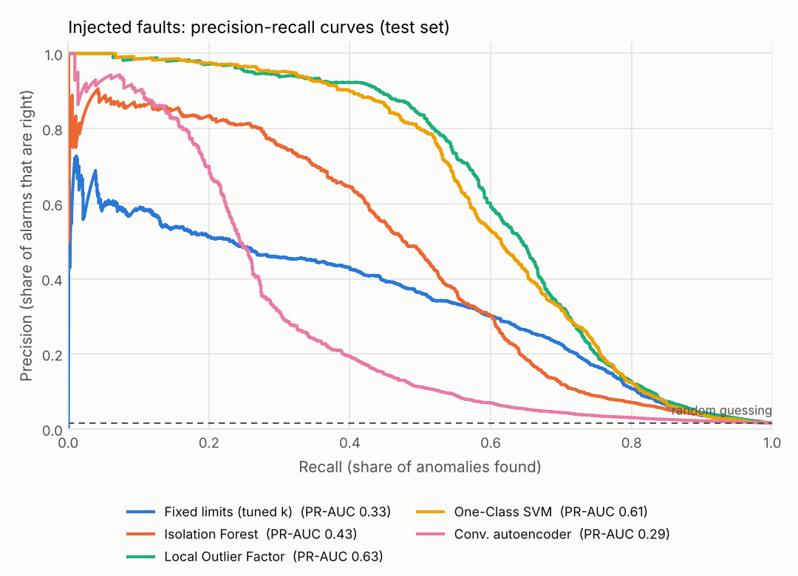
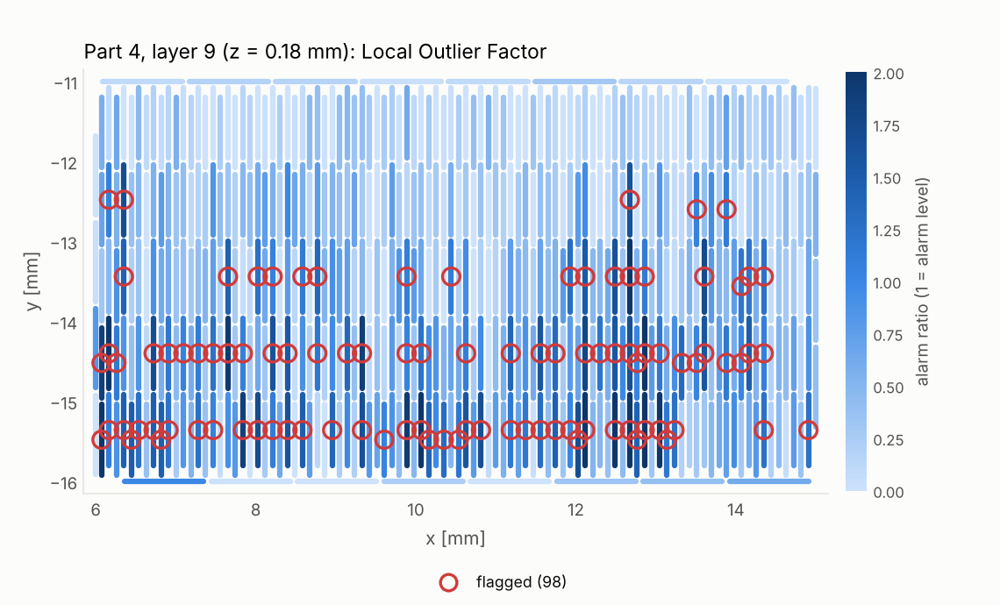

# Finding problems in metal 3D printing data


When a metal part is 3D printed, a laser melts metal powder layer by layer.
A camera watches the small pool of melted metal (the "melt pool") the whole
time. This project teaches computer models what a **normal** melt pool looks
like, and then lets them point out the spots that look **unusual**, because
those spots could become defects.

The main question: **can a learned model find problems with fewer false
alarms than simple fixed limits** (the usual "reject if the value is too high
or too low" check used in factories)?

## Main result in short

- Data: 4 printed parts from NIST. Models learn on parts 1 and 2, the alarm
  level is set on part 3, and the final test is on part 4.
- I added fake faults (spikes, drops, slow drifts, noise) to part 4, so I
  know exactly where the problems are.
- **Two models (LOF and One-Class SVM) catch a bit more faults than fixed
  limits** when false alarms are kept low: about 67 % against 61 % of the
  faults, with 1 % false alarms.
- When you must catch 90 % of faults, all three are about the same.
- Real defects (pores) could not be tested, because the X-ray scan data
  showed no clear pores at the checked spots.
- All numbers come from **one test part** and **fake faults**, so treat them
  as a first comparison, not proof.

The short report with all the details is in [`docs/report.md`](docs/report.md).

## The data

NIST "Overhang Part X4" dataset (2025), ID `mds2-3761`:

- 4 identical parts in nickel alloy 625, 250 layers each.
- Each part has a sloped overhang and a round hole. There the laser melts
  over loose powder instead of solid metal, so the melt pool behaves
  differently. That is "different", not "broken".
- The camera takes 10 000 pictures per second. NIST turned each picture into
  numbers: melt pool length, width and area.
- Each picture is matched to the laser position, the laser power and the
  X-ray (CT) scan of the finished part at that spot.
- One CSV file per layer.

More about the columns: [`docs/data_notes.md`](docs/data_notes.md).

## How it works

1. **Load** the layer files (`src/load.py`).
2. **Cut** each laser line into short pieces of 12 pictures (about 1 mm). Each
   piece gets one score (`src/features.py`).
3. **Describe** each piece with simple numbers: average, spread, lowest,
   highest, trend and jumpiness (`src/features.py`).
4. **Add fake faults** to the test part so the right answers are known
   (`src/inject.py`).
5. **Train** each model on normal pieces only, then score the test part
   (`src/models/`).
6. **Compare** how many faults each model catches and how many false alarms
   it gives (`src/evaluate.py`).
7. **Draw** plots and a list of every flagged spot (`src/plots.py`).

The 4 kinds of fake faults (red bar) and where LOF raised an alarm (green):


Models compared:

| Model | Idea in one line |
|---|---|
| Fixed limits (3-sigma and tuned) | Alarm if a value is too far from normal. The usual factory check. |
| Isolation Forest | Unusual pieces are easy to split off from the rest. |
| LOF (Local Outlier Factor) | Unusual pieces have few similar neighbours. |
| One-Class SVM | Draw a tight border around normal data. |
| Autoencoder | A small neural network learns to copy normal signals; a bad copy means unusual. |

To keep the test fair, nothing is ever fitted on the test part, and every
model gets the same data.

## Quick start (fake sample data, about 30 seconds)

```bash
git clone https://github.com/dvschandraprasad/am-process-anomaly-detection_.git
cd am-process-anomaly-detection_
python -m venv .venv && source .venv/bin/activate
pip install torch --index-url https://download.pytorch.org/whl/cpu   # CPU-only PyTorch, as in CI
pip install -r requirements.txt

pytest -q                                                   # run the tests
python scripts/run_pipeline.py --config configs/sample.yaml # run everything
```

Results go to `results/sample/`. The sample data in `data/sample/` is
**made up**. It only shows that the code runs.

## Run on the real NIST data

```bash
# 1. Download one part first (large file) and look inside
python scripts/download_data.py --parts 1
python scripts/inspect_data.py data/raw/part1

# 2. First run with one part
python scripts/run_pipeline.py --config configs/nist_x4_one_part.yaml

# 3. Download the rest, check the X-ray values, and do the full run
python scripts/download_data.py --parts 2 3 4
python scripts/check_xct.py --config configs/nist_x4.yaml
python scripts/run_pipeline.py --config configs/nist_x4.yaml

# 4. Extra numbers used in the docs (after step 3)
python scripts/extra_numbers.py --config configs/nist_x4.yaml
```

Tips:

- Before step 2, read the output of `inspect_data.py` and the notes in
  [`docs/data_notes.md`](docs/data_notes.md).
- The NIST zip files unpack one folder deeper. That is fine: the loader looks
  in all sub-folders.
- The full run takes about 3 to 4 minutes and needs about 3 GB of memory.
- To explore by hand, open `notebooks/01_explore.ipynb` and
  `notebooks/02_results.ipynb`.

## Results (test part 4)

"Caught" = share of faulty pieces found. "False alarms" = share of normal
pieces wrongly flagged. "Overall score" (PR-AUC) goes from 0 to 1; higher is
better, and random guessing gets about 0.015.

| Model | Caught | False alarms | Overall score |
|---|---:|---:|---:|
| Fixed limits (3-sigma) | 83 % | 10.9 % | 0.58 |
| Fixed limits (tuned) | 65 % | 1.4 % | 0.58 |
| Isolation Forest | 51 % | 1.1 % | 0.42 |
| **LOF** | **70 %** | 2.0 % | **0.67** |
| **One-Class SVM** | **70 %** | 1.5 % | **0.65** |
| Autoencoder | 32 % | 1.1 % | 0.30 |



What this means:

- **Fixed limits are a strong, simple baseline.**
- **LOF and One-Class SVM are a little better** when false alarms must stay low.
- **Isolation Forest and the autoencoder are weaker** here, mostly because
  they miss slow drifts.
- **Choosing good input numbers matters as much as choosing the model.**
- Many alarms on the clean part come from layer 1 (printed straight on the
  base plate) and from the ends of laser lines.

The heatmap shows where LOF raised alarms on layer 9 of the test part:



Every flagged spot is listed in `traceability.csv` with part, layer,
position and time, so someone can go and check that exact spot.

More tables (results by fault type, by region, X-ray check):
[`docs/report.md`](docs/report.md).

## Limits

- Only **one test part**, from one machine, one material and one shape.
- The faults are **fake**. Catching them shows a model reacts to that kind
  of signal change, not that it finds real defects.
- **Real pores were not tested.** The X-ray check cannot see small pores,
  pores between checked spots, or pores near the surface.
- About 11 % of the pictures get no score (very short lines and leftover
  ends of lines).
- It does not run in real time and does not control a printer.

## Folder layout

```
├── configs/     settings for the sample and NIST runs
├── data/        raw/ (NIST downloads, not in Git) and sample/ (fake data)
├── docs/        report, data notes, images
├── notebooks/   01_explore, 02_results
├── scripts/     download, inspect, check_xct, run_pipeline, extra_numbers
├── src/         the code (load, features, labels, inject, models, evaluate, plots)
└── tests/       pytest, run in GitHub Actions
```

## Sources

- Z. Yang, Y. Lu, H. Yeung, B. Lane, N. Van Handel (2025). *A Fully Registered
  In-Situ and Ex-Situ Dataset for Metal Powder Bed Fusion Additive
  Manufacturing.* NIST AMS 100-69. https://doi.org/10.6028/NIST.AMS.100-69
  (data: NIST dataset `mds2-3761`)
- B. Lane, H. Yeung (2020). *Process Monitoring Dataset from the Additive
  Manufacturing Metrology Testbed (AMMT): Overhang Part X4.* J. Res. NIST 125.
  https://doi.org/10.6028/jres.125.027
- NIST AMMT process monitoring datasets: https://www.nist.gov/node/1560441

## License

Code: MIT. The NIST data has its own terms; see the NIST pages above.

Developed with AI assistance (Claude).
