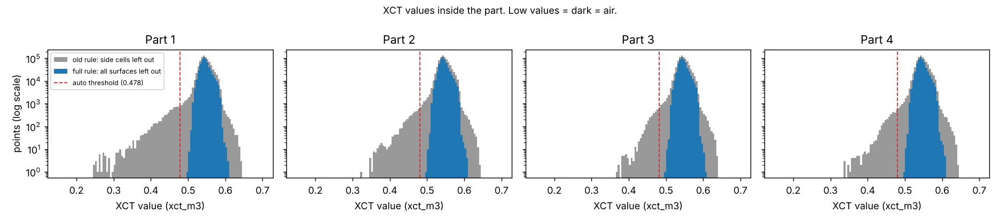

# Data notes

Dataset: **NIST "Overhang Part X4", fully registered** (ID `mds2-3761`).
Description: NIST AMS 100-69, https://doi.org/10.6028/NIST.AMS.100-69

This file has two parts: what the description says, and what still has to be
checked on the real files.

## What the description says

- Four parts. One folder per part, **250 CSV files per part, one per layer**.
- **40 columns**, only numbers.
- **One row = one melt pool camera frame.** The camera takes 10 000 frames per
  second, only while the laser is on. Rows without an image were removed.
- Rows are in time order. A time gap between two rows means the laser was off
  (a new scan track starts).
- Positions are in the machine coordinate system, in mm.
- Part size about 9 × 5 × 5 mm, 250 layers of 20 µm.
- The scan direction turns 90° from layer to layer.
- The first image of each track often shows no melt pool.

### Columns (by position)

| # | Name in this repo | Unit | Meaning |
|---|---|---|---|
| 1 | `part` | – | Part number 1–4 |
| 2 | `time_us` | µs | Build time |
| 3, 4 | `x`, `y` | mm | Commanded laser position |
| 5 | `cmd_power` | W | Commanded laser power |
| 6 | `cmd_speed` | mm/s | Commanded scan speed |
| 7, 8 | `x_real`, `y_real` | mm | Measured laser position |
| 9 | `power` | W | Measured laser power |
| 10 | `speed` | mm/s | Measured scan speed (smoothed) |
| 11–13 | `mp_length_80`, `mp_width_80`, `mp_area_80` | mm, mm, mm² | Melt pool size, image threshold 80 |
| 14–16 | `mp_length_100`, `mp_width_100`, `mp_area_100` | mm, mm, mm² | Melt pool size, threshold 100 (**used by default**) |
| 17–19 | `mp_length_120`, `mp_width_120`, `mp_area_120` | mm, mm, mm² | Melt pool size, threshold 120 |
| 20–28 | `lwi_powder_{a,b,c}`, `…_m3`, `…_m5` | – | Layer camera after powder spreading, lights A/B/C: raw, 3×3 mean, 5×5 mean |
| 29–37 | `lwi_scan_{a,b,c}`, `…_m3`, `…_m5` | – | Layer camera after the laser scan, same order |
| 38 | `xct` | – | X-ray CT voxel value at this position |
| 39 | `xct_m3` | – | XCT after 3×3×3 mean filter (**used for pore labels**) |
| 40 | `xct_m5` | – | XCT after 5×5×5 mean filter |

Columns are named by position because several labels in the NIST tables repeat.

### How the numbers were made (short)

- **Melt pool size:** each camera image is turned black/white at a threshold
  (80, 100 or 120). Area = biggest white blob. Length and width = long and
  short axis of an ellipse fitted to it. These are *apparent* sizes from
  brightness, not true temperatures.
- **Layer camera:** each point takes the nearest pixel of the layer image.
  Lining up can be off by about 2 pixels; the mean-filtered values cope with that.
- **XCT:** measured as 16-bit values, resampled to 10 µm voxels, lined up with
  the build using reference surfaces. Position uncertainty about 1.2 voxels.
  In the files the values are scaled to lie between 0 and 1.

## What the real files show

Seen in **part 1, layers 120 to 140** (21 files, 16 November 2026). The
full download is described in the next section.

| Point | What was seen |
|---|---|
| File names | `L0120.csv` … `L0140.csv`. The layer number is read correctly. |
| Header line | No |
| Columns | 40, separated by commas. No empty values. |
| Rows per layer | 3 723 to 3 968 (about 0.9 MB per file) |
| Time step | 100 µs between frames. About 3 000 µs between tracks. A few single frames are missing (200 µs steps). |
| Time column | Starts again in every layer (about 77 500 µs at the first row). It is time inside the layer, not since the start of the build. (Parts 2 to 4 start later in the layer; see below.) |
| Laser settings | Two: 100 W at about 900 mm/s (contour) and 195 W at about 800 mm/s (infill). About 10 % of frames are contour. |
| Measured power | About 177 to 186 W when 195 W is commanded. Near 0 W in the first frame of a track. |
| Measured speed | Noisy (standard deviation about 160 mm/s). |
| Position | x from −6 to 3 mm, y from 11 to 16 mm (machine coordinates). |
| Shape in these layers | Not a full rectangle: two thin walls (0.5 mm) on the left side, and a step on the right side. |
| Track length | From 1 to 113 frames. Many tracks across the thin walls have only 7 frames. |
| XCT values | **Between 0 and 1** (not 16-bit whole numbers). Middle value 0.537 inside the part. |
| XCT: dark or bright pores | Points at the part surface (metal mixed with air) go down to 0.34. So air is **dark**, and pores should be low values. `pore_is: low` is right. |
| Layer camera values | 0 to 255. Light A in the powder view is close to its top value (middle value 247), so it shows little. |

### What "normal" looks like (layers 120 to 140)

- **Infill (195 W):** melt pool area about 0.021 mm² (std 0.005), length about
  0.24 mm, width about 0.11 mm.
- **Contour (100 W):** area about 0.011 mm² (std 0.003), length about 0.15 mm,
  width about 0.09 mm.
- **Start of a track:** the first frame has **no melt pool** (all sizes are 0).
  The area then grows over about 3 frames (0.015, 0.017, 0.022 mm²) before it
  is steady. Zeros appear only in first frames.
- **XCT inside the part:** values lie in a narrow, even band (1 % of points
  below 0.498, 1 % above 0.575). There is no clear group of dark pore values
  in these layers. (The full parts confirm this; see below.)

## The full download (all four parts)

Checked on 17 November 2026 with `scripts/inspect_data.py`,
`scripts/check_xct.py` and the full run (`configs/nist_x4.yaml`).

| Point | What was seen |
|---|---|
| Folders | Each zip unpacks one folder deeper: `part1/part01/L0001.csv` … `part4/part04/L0250.csv`. The loader searches sub-folders, so this works as is. |
| Files | All 250 layers of all 4 parts are there, same names, 40 columns, no header. |
| Rows | **1 187 088 rows in every part.** Every layer has the same number of rows in all four parts (3 568 to 6 367 per layer, middle value 4 444). The scan plan is the same; the measured values differ. |
| Empty values | Layer 1 has no layer camera and no XCT values (columns 20 to 40 are `NaN`). The lowest layers have no XCT values: layers 1–18 in part 1, 1–19 in part 2, 1–20 in parts 3 and 4. Nothing else is empty. |
| Time column | Time since the start of the layer, for the whole build plate. The parts are scanned one after the other: the first row of a layer is at about 0.08 s in part 1, 1.0 s in part 2, 2.0 s in part 3 and 3.0 s in part 4. |
| Time precision | **The files store the time with 5 significant digits** (for example `3.1712e+06`). Above 1 000 000 µs (most of parts 2 to 4) neighbouring frames then often get the same time: steps of 200, 0, 200, 0 µs, while the laser moves on by 0.08 mm per frame as usual. The code no longer treats a step of 0 as the start of a new track. With that, all four parts give the same 23 999 tracks. |
| Short tracks | Tracks shorter than 13 frames get no score: 3.2 % of all frames in each part. |
| Place on the build plate | Part 1: x −6 to 3, y 11 to 16 mm. Part 2: x −2 to 7, y 2 to 7. Part 3: x 2 to 11, y −7 to −2. Part 4: x 6 to 15, y −16 to −11. The four parts sit on a diagonal line. |
| Melt pool size per part | Infill (195 W), frames with a melt pool, middle value of the area (threshold 100): part 1 0.0213, part 2 0.0223, part 3 0.0228, part 4 0.0238 mm². It grows a little from part 1 to part 4. Contour (100 W): 0.0112 to 0.0115 mm² in all parts. |
| Layer 1 | The first layer on the build plate has a bigger melt pool. Part 4, infill: 0.0287 mm² in layer 1, 0.0236 mm² in layers 51 to 250. |
| Overhang region | Less than 0.5 mm solid metal below: 5.6 % of all frames, in layers 64 to 250. Over it the infill melt pool is only 2 to 4 % bigger (middle value). Directly over powder (less than 0.1 mm metal below) it is smaller: 0.0172 to 0.0196 mm². |

The melt pool numbers above are middle values over frames with
`cmd_power` 195 W and `mp_area_100` > 0, worked out from the loaded parts
(`data/processed/`). They are not written by the pipeline.

### XCT on the full parts

Numbers from `python scripts/check_xct.py --config configs/nist_x4.yaml`.

**With the old surface rule** (only cells next to an empty cell in the same
layer are left out), the automatic threshold (median − 6 robust std, about
0.463 to 0.465) gives:

| Part | Points below the threshold | In the lowest 3 XCT layers | In the top 2 layers | Elsewhere at a surface | Away from any surface |
|---|---:|---:|---:|---:|---:|
| 1 | 4 174 | 2 990 | 744 | 440 | 0 |
| 2 | 1 971 | 803 | 713 | 455 | 0 |
| 3 | 1 117 | 159 | 594 | 364 | 0 |
| 4 | 1 474 | 179 | 702 | 593 | 0 |

"Elsewhere at a surface" is mostly:
- top faces of regions that end, in the same layers in all four parts
  (layers 25–26 and 49–50; the cross-section starts to shrink at layer 27
  and the number of frames per layer drops by about 30 % at layer 51);
- the outer side faces at the largest y and the largest x of each part.
  The old rule missed them because these points lie exactly on a cell border.

So all low XCT values are at a surface, where an XCT voxel holds metal and
air. They are **not** pores.

**With the full surface rule** (`labels.add_xct_surface`: points closer than
0.5 mm to the outside in the same layer, or closer than 0.06 mm to a top
face, a face over powder or the start of the XCT scan, are left out):

| Part | Inner points | Middle value | Lowest value | Auto threshold | Points below it |
|---|---:|---:|---:|---:|---:|
| 1 | 588 702 | 0.5443 | 0.4954 | 0.4782 | 0 |
| 2 | 583 814 | 0.5440 | 0.4991 | 0.4802 | 0 |
| 3 | 579 097 | 0.5441 | 0.4990 | 0.4812 | 0 |
| 4 | 579 247 | 0.5441 | 0.4997 | 0.4801 | 0 |

The full rule leaves out about 45 % of the points with an XCT value. The
threshold of the full run comes from the inner points of parts 1 and 2:
0.479.

**Conclusion.** These four parts show **no pores** away from the surface at
the XCT resolution (10 µm voxels, 3 × 3 × 3 mean). `pore_is: low` is right
(air is dark), and `threshold: auto` is kept. But XCT gives no pore labels
here, so the methods cannot be checked against real pores. Pores close to a
surface (where they are often found in this kind of part) cannot be told
apart from the surface itself with this method.
