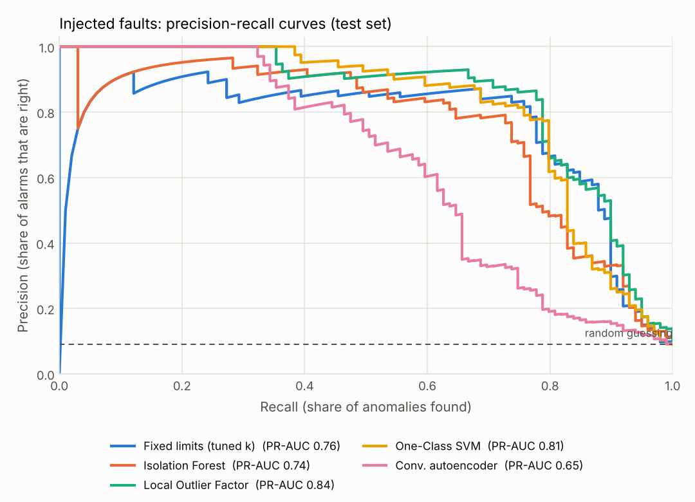
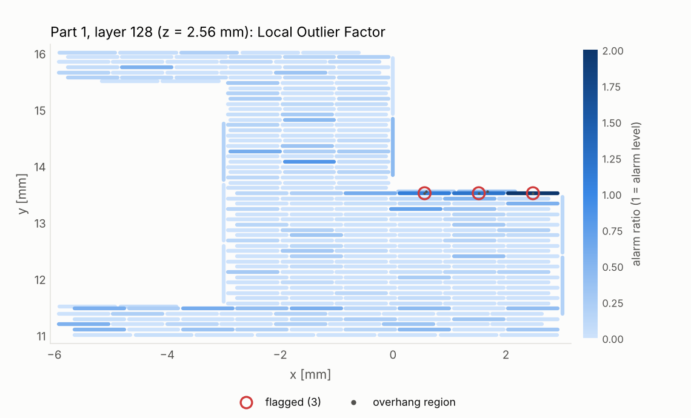

# First check on real NIST data

**Date:** 16 November 2026
**Data:** NIST Overhang Part X4, registered dataset `mds2-3761`, **part 1, layers 120 to 140** (21 layer files, `L0120.csv` to `L0140.csv`, 81 001 rows).
**Config:** [`configs/nist_x4_layers_120_140.yaml`](../configs/nist_x4_layers_120_140.yaml)

This run answers one question: **does the code work on the real files?** Yes.
It is **not** the final result. It uses 21 of 1000 layer files, from one part.

## How to repeat it

```bash
python scripts/download_data.py --parts 1
python scripts/run_pipeline.py --config configs/nist_x4_layers_120_140.yaml
```

## Setup

| | |
|---|---|
| Split | Blocks of 2 layers: train, train, train, validation, test, and so on |
| Train layers | 120–125, 130–135, 140 (13 layers, 3 568 segments) |
| Validation layers | 126, 127, 136, 137 (1 098 segments) |
| Test layers | 128, 129, 138, 139 (1 096 segments) |
| Segment | 12 camera frames in a row on one track (1.2 ms) |
| Injected faults | 47 faults in the test layers, 99 faulty segments (9 % of test segments) |
| Alarm level | Set on the validation layers: 1 % of normal segments flagged |
| Seeds | 3 for methods with randomness; tables show mean ± std |

## Results: injected faults (test layers)

| Method | Precision | Recall | F1 | False rejection rate | PR-AUC | FRR at 90 % recall |
|---|---:|---:|---:|---:|---:|---:|
| Fixed limits (3-sigma rule) | 0.624 | 0.838 | 0.716 | 5.0 % | 0.758 | 10.9 % |
| Fixed limits (tuned k) | 0.855 | 0.596 | 0.702 | 1.0 % | 0.758 | 10.9 % |
| Isolation Forest | 0.832 ± 0.016 | 0.599 ± 0.025 | 0.696 ± 0.016 | 1.2 ± 0.2 % | 0.741 ± 0.009 | 17.4 ± 1.1 % |
| Local Outlier Factor | 0.869 | 0.737 | 0.798 | 1.1 % | 0.838 | 9.1 % |
| One-Class SVM | 0.829 | 0.687 | 0.751 | 1.4 % | 0.814 | 20.9 % |
| Conv. autoencoder | 0.724 ± 0.028 | 0.522 ± 0.025 | 0.607 ± 0.027 | 2.0 ± 0.2 % | 0.645 ± 0.018 | 47.4 ± 0.7 % |



### Share of injected faults caught, by kind

| Method | drift | drop | noise | spike |
|---|---:|---:|---:|---:|
| Fixed limits (3-sigma rule) | 100 % | 100 % | 100 % | 100 % |
| Fixed limits (tuned k) | 75 % | 100 % | 91 % | 55 % |
| Isolation Forest | 47 % | 78 % | 100 % | 94 % |
| Local Outlier Factor | 83 % | 100 % | 100 % | 91 % |
| One-Class SVM | 75 % | 100 % | 100 % | 91 % |
| Conv. autoencoder | 25 % | 72 % | 100 % | 79 % |


The black line is the real melt pool area. The dips to zero are real: the
first camera frame of every track shows no melt pool.

### False rejections by region

| Method | Solid metal below | Overhang region |
|---|---:|---:|
| Fixed limits (3-sigma rule) | 4.6 % | 29.4 % |
| Fixed limits (tuned k) | 0.7 % | 17.6 % |
| Isolation Forest | 0.4 % | 47.1 % |
| Local Outlier Factor | 0.7 % | 23.5 % |
| One-Class SVM | 0.8 % | 35.3 % |
| Conv. autoencoder | 1.8 % | 11.8 % |

The overhang column rests on only 17 normal test segments, so these
percentages are rough.

## Results: clean test layers and X-ray CT

On the test layers without injected faults, 29 of 1 096 segments were flagged
by at least one tuned method (15 by one method, 6 by two, 4 by three, 4 by
four). 34 % of them lie in the overhang region.



Layer 128, Local Outlier Factor. The three alarms sit on the edge at
y ≈ 13.5 mm, where this layer reaches out over powder.

**XCT pores.** With the default threshold (0.471), no test segment contains a
pore. The lowest XCT value in a test segment away from the surface is 0.482.
So precision and recall against XCT cannot be given for these layers.

**Anomaly score against XCT value** (Spearman rank correlation, 922 segments
away from the surface):

| Method | Rank correlation |
|---|---:|
| Fixed limits (tuned k) | −0.017 |
| Isolation Forest | 0.005 |
| Local Outlier Factor | −0.036 |
| One-Class SVM | 0.043 |
| Conv. autoencoder | 0.010 |

All values are close to zero. In these layers there is no visible link between
how unusual the melt pool is and the XCT value.

## What this shows

- The loader reads the real files with no changes: 40 columns, no header,
  layer number from the file name.
- The alarm level carries over from validation to test layers: every tuned
  method flags 1.0 to 2.0 % of normal test segments (target 1 %).
- The 3-sigma rule catches the most faults, but it flags 5 % of normal
  segments. At about 1 % false rejections, Local Outlier Factor finds 74 % of
  the faulty segments and tuned fixed limits find 60 %.
- Slow drifts are the hardest kind for most methods.
- The autoencoder is the weakest here. It had only 3 568 training segments.
- False rejections are much more common in the overhang region than over
  solid metal, for every method.

## What this does not show

- **It is a small piece of one part.** Numbers will change on the full data.
- **The split is by layer blocks, not by part.** Neighbouring layers look
  alike, so this is an easier test than testing on an unseen part.
- **Injected faults are synthetic.** They are not real defects.
- **The overhang region is under-counted here.** Below the first loaded layer
  (120) the code assumes solid metal. With all 250 layers loaded this is
  worked out properly.
- **Nothing can be said about real pores** from these 21 layers.
