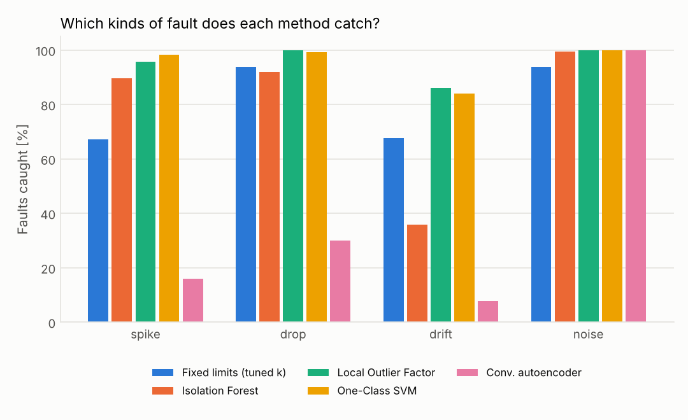

# Anomaly detection in melt pool monitoring data: short report

> Results from the full run on all four NIST parts, 17 November 2026
> (`configs/nist_x4.yaml`). Every number in sections 4 and 5 comes from the
> files that run wrote to `results/nist_x4/`, unless it says otherwise.

## 1. Goal

On a production line, measurements are often checked against fixed limits.
This works when "normal" is the same everywhere. In laser powder bed fusion it
is not: the melt pool behaves differently over solid metal and over loose
powder (overhangs), and differently for contour and infill scans.

Question: **can a model that learns normal behaviour find real problems with
fewer false rejections than fixed limits?**

## 2. Data

NIST "Overhang Part X4", fully registered dataset (`mds2-3761`, NIST AMS 100-69).

- 4 nominally identical parts in nickel alloy 625, 250 layers of 20 µm each.
- A high-speed camera on the laser path recorded the melt pool at 10 000
  frames per second. NIST extracted melt pool length, width and area.
- Each frame is registered with laser position and power, the layer camera
  and the X-ray CT (XCT) value of the finished part.

Signals used: melt pool length, width and area (image threshold 100).

Each part has 1 187 088 rows (camera frames) in 250 layer files. Cut into
segments: 88 378 segments per part (train 176 756, validation 88 378,
test 88 378). The lowest 18 to 20 layers have no XCT value. More in
[`data_notes.md`](data_notes.md).

## 3. Method

**Unit of analysis.** Each laser track is cut into segments of 12 frames
(1.2 ms, about 1 mm of travel). Each segment gets one anomaly score.

**Features.** Per segment and signal: mean, standard deviation, minimum,
maximum, slope and jitter (mean change from frame to frame). Plus three things
known before printing: the laser setting, whether the segment is the start of
a track (the melt pool needs a few frames to grow), and how much solid metal
is below the segment.

**Split.** Parts 1–2 for training, part 3 for validation, part 4 for testing.
Whole parts are kept together, so the test part is truly unseen.

**Training.** Only normal segments (no XCT pore) are used for training.

**Methods.** Fixed limits (3-sigma rule, and with tuned k), Isolation Forest,
Local Outlier Factor, One-Class SVM, and a small 1D convolutional autoencoder
on the raw frames.

**Alarm level.** For every method the alarm level is set on the validation
part so that 1 % of normal segments are flagged. Only the 3-sigma rule keeps
its fixed level. The test part is never used for tuning.

**Labels.**
1. *Injected faults* in the test part: spikes, drops, drifts and noise bursts
   with known place and size.
2. *XCT pores:* segments where the XCT value is beyond the pore threshold.
   Points near any surface of the part (sides, top faces, faces over powder,
   start of the XCT scan) are left out, because XCT there mixes metal and air.
3. *Overhang region:* less than 0.5 mm solid metal below. This is not a
   defect; it is used to see where false rejections come from.

**Metrics.** Precision, recall, F1, false rejection rate (normal segments
flagged ÷ all normal segments), PR-AUC, share of faults caught per fault kind,
and run time per layer.

## 4. Results

Train: parts 1 and 2. Alarm level: part 3. Test: part 4. 594 injected
faults in part 4 give 1 362 faulty segments (1.5 % of 88 378). Methods with
randomness ran with 3 seeds (mean ± std).

**Injected faults (test part 4)**

| Method | Precision | Recall | F1 | False rejection rate | PR-AUC | FRR at 90 % recall | Run time [ms/layer] |
|---|---:|---:|---:|---:|---:|---:|---:|
| Fixed limits (3-sigma rule) | 0.118 | 0.789 | 0.206 | 9.2 % | 0.334 | 37.7 % | 0.060 |
| Fixed limits (tuned k) | 0.341 | 0.522 | 0.413 | 1.6 % | 0.334 | 37.7 % | 0.091 |
| Isolation Forest | 0.407 ± 0.005 | 0.519 ± 0.016 | 0.456 ± 0.009 | 1.2 ± 0.0 % | 0.432 ± 0.025 | 36.8 ± 1.3 % | 2.310 ± 0.148 |
| Local Outlier Factor | 0.348 ± 0.005 | 0.686 ± 0.005 | 0.462 ± 0.003 | 2.0 ± 0.1 % | 0.626 ± 0.003 | 30.7 ± 0.2 % | 11.338 ± 0.196 |
| One-Class SVM | 0.391 ± 0.008 | 0.656 ± 0.007 | 0.489 ± 0.005 | 1.6 ± 0.1 % | 0.609 ± 0.006 | 32.5 ± 3.3 % | 2.276 ± 0.151 |
| Conv. autoencoder | 0.304 ± 0.018 | 0.306 ± 0.022 | 0.305 ± 0.020 | 1.1 ± 0.0 % | 0.287 ± 0.018 | 62.7 ± 1.6 % | 0.480 ± 0.053 |

**Share of injected faults caught, by kind**

| Method | drift | drop | noise | spike |
|---|---:|---:|---:|---:|
| Fixed limits (3-sigma rule) | 99 % | 100 % | 100 % | 98 % |
| Fixed limits (tuned k) | 68 % | 94 % | 94 % | 67 % |
| Isolation Forest | 36 % | 92 % | 100 % | 90 % |
| Local Outlier Factor | 86 % | 100 % | 100 % | 96 % |
| One-Class SVM | 84 % | 99 % | 100 % | 98 % |
| Conv. autoencoder | 8 % | 30 % | 100 % | 16 % |

**False rejections by region** (normal test segments: 83 626 with solid
metal below, 3 390 in the overhang region)

| Method | Solid metal below | Overhang region |
|---|---:|---:|
| Fixed limits (3-sigma rule) | 9.3 % | 7.4 % |
| Fixed limits (tuned k) | 1.6 % | 1.0 % |
| Isolation Forest | 0.5 ± 0.0 % | 18.8 ± 0.6 % |
| Local Outlier Factor | 1.9 ± 0.1 % | 4.3 ± 0.3 % |
| One-Class SVM | 1.3 ± 0.1 % | 9.1 ± 0.1 % |
| Conv. autoencoder | 1.1 ± 0.0 % | 2.0 ± 0.2 % |

**XCT pores.** No test segment away from the surface has an XCT value below
the threshold (0.479). In fact no such point exists in any of the four
parts (see [`data_notes.md`](data_notes.md#xct-on-the-full-parts)). So
precision and recall against XCT cannot be given.

**Anomaly score against XCT value** (Spearman rank correlation, 47 838 test
segments away from the surface, no injected faults):

| Method | Rank correlation |
|---|---:|
| Fixed limits (tuned k) | −0.143 |
| Isolation Forest | −0.160 ± 0.005 |
| Local Outlier Factor | −0.092 ± 0.003 |
| One-Class SVM | −0.001 ± 0.005 |
| Conv. autoencoder | −0.048 ± 0.001 |

**Alarms on the clean test part.** 3 915 of 88 378 segments were flagged by
at least one tuned method (2 382 by one method, 861 by two, 434 by three,
163 by four, 75 by all five). 325 of them are in layer 1.

Layer 1, Local Outlier Factor: 247 of the 469 segments in this layer are
flagged.

## 5. What the results mean

- **Lowest false rejection rate on the test part:** the autoencoder (1.1 %)
  and Isolation Forest (1.2 %). All tuned methods flag 1.1 to 2.0 % of
  normal segments, against the 1 % they were set to on part 3. So the
  alarm level carries over from part to part only roughly. The melt pool
  of part 4 is a little bigger than that of parts 1 to 3
  ([`data_notes.md`](data_notes.md)), which may explain part of this.
- **Better than fixed limits?** At a low alarm rate, yes. Local Outlier
  Factor and One-Class SVM find 69 % and 66 % of the faulty segments at
  2.0 % and 1.6 % false rejections. Tuned fixed limits find 52 % at 1.6 %.
  PR-AUC: 0.63 and 0.61 against 0.33. The 3-sigma rule finds 79 %, but at
  9.2 % false rejections.
- **At high recall, no.** To catch 90 % of the faulty segments, every
  method except the autoencoder must flag 30.7 to 37.7 % of normal
  segments.
- **Fault kinds.** Noise bursts are caught by all methods (94 to 100 %).
  Slow drifts are the hardest: 36 % for Isolation Forest, 68 % for tuned
  fixed limits, 84 to 86 % for One-Class SVM and Local Outlier Factor.
  The autoencoder misses most drifts, drops and spikes (8 %, 30 % and
  16 %). Why has not been checked.
- **Where the false rejections sit.** Isolation Forest flags 18.8 % of the
  normal overhang segments and One-Class SVM 9.1 %, against 0.5 % and 1.3 %
  over solid metal. Local Outlier Factor: 4.3 % against 1.9 %. The tuned
  fixed limits, which keep separate limits for the overhang region, flag
  1.0 % there. The amount of metal below is an input to every method, but
  only the fixed limits use it to keep separate limits.
- **Layer 1.** The first layer on the build plate has a bigger melt pool.
  Local Outlier Factor flags 52.7 % and One-Class SVM 56.1 % of its
  segments; the 3-sigma rule 75.5 %. Layer 1 holds only 469 of the 88 378
  test segments, but 325 of the 3 915 flagged ones. (Share per layer worked
  out from `scores_test.parquet`.) This is a real difference in the
  process, not a defect.
- **XCT.** The alarms cannot be checked against pores, because XCT shows
  none away from the surface. The rank correlation is weak (at most −0.16).
  When the score and the XCT value are both ranked inside each layer, it
  gets weaker still (for example −0.09 for Isolation Forest and −0.04 for
  the tuned fixed limits, worked out from `scores_test.parquet`). So part
  of it comes from slow changes up the part, not from single spots. It is
  not evidence that any method finds pores.
- **Top of `traceability.csv`.** The top rows are segments flagged by all
  five tuned methods, spread over many layers (for example layers 104, 152,
  118, 64, 227) over solid metal. Nobody has looked at these spots in the
  raw data yet.

## 6. Limits of this work

- One machine, one material, one part shape, four parts.
- Injected faults are synthetic. They test if a method reacts to a kind of
  signal change, not if it finds real defects.
- XCT pore labels depend on a threshold that we chose. In these four parts
  XCT shows no pores away from the surface, so real defects are not tested.
  Points near a surface are left out, so pores close to a surface cannot be
  seen with this method.
- Only one test part. There is no spread over test parts.
- Melt pool sizes come from image brightness and are affected by the camera
  settings and motion blur.
- Segments are short (1.2 ms). Problems that build up over many tracks or
  layers are not looked at.
- Tracks shorter than 13 frames (short scan lines across thin walls) get no score.
- Nothing here runs in real time.

## 7. Recommendations

These follow from the results above. They rest on one test part and on
synthetic faults, so treat them as starting points.

- **Set limits per region and per laser setting**, not one limit for the
  whole part. The tuned fixed limits, which do this, flag 1.0 % of normal
  overhang segments. Isolation Forest, which only gets the region as one
  input among many, flags 18.8 % there.
- **Choose the alarm level from a false rejection budget** (for example 1 %)
  on parts known to be good, and **re-check it on every new part.** Set for
  1 % on part 3, the methods flagged 1.1 to 2.0 % on part 4.
- **Keep the fixed limits as a baseline next to any learned model.** Here
  Local Outlier Factor and One-Class SVM were clearly better at a low alarm
  rate (recall 0.69 and 0.66 against 0.52), but not when 90 % of faults
  must be caught.
- **Treat known special layers on their own**, like the first layer on the
  build plate. Otherwise they fill the alarm list.
- **Keep every alarm traceable** to part, layer and position, so that it can
  be checked against inspection (here: XCT).
- **Before using this in production:** collect labelled data with real
  defects (these parts have no pores that XCT can see), test on more parts
  and shapes, watch for drift of "normal" over time, and measure the run
  time on the real data rate.
