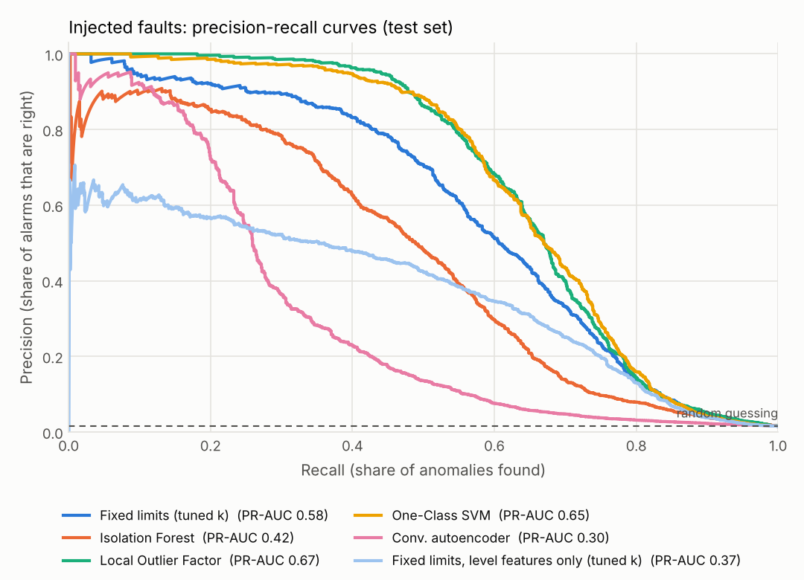
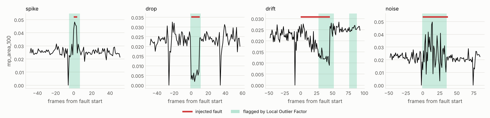
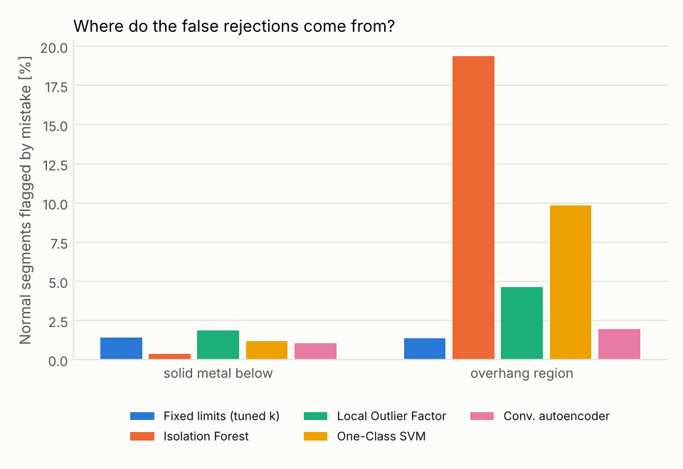
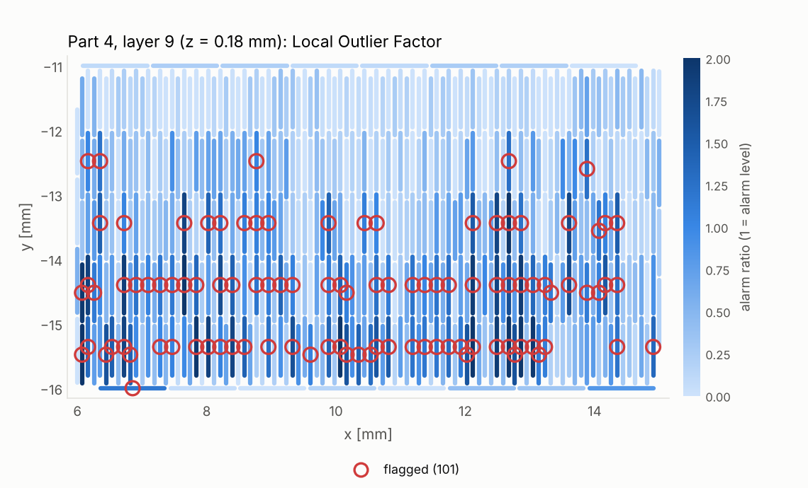

# Anomaly detection in melt pool monitoring data: short report

> Results from the full run on all four NIST parts, 17 November 2026
> (`configs/nist_x4.yaml`). Every number in sections 4 and 5 comes from the
> files that run wrote to `results/nist_x4/`. A few numbers (alarms per
> layer, rank correlation inside each layer, melt pool size per part) come
> from `results/nist_x4/extra_numbers.md`, which
> `python scripts/extra_numbers.py --config configs/nist_x4.yaml` writes
> from the same run.

## 1. Goal

On a production line, measurements are often checked against fixed limits.
This works when "normal" is the same everywhere. In laser powder bed fusion it
is not: the melt pool behaves differently over solid metal and over loose
powder (overhangs), and differently for contour and infill scans.

Question: **can a model that learns normal behaviour find real problems with
fewer false rejections than fixed limits?**

## 2. Data

NIST "Overhang Part X4", fully registered dataset (`mds2-3761`, NIST AMS 100-69).

- 4 nominally identical parts in nickel alloy 625, 250 layers of 20 µm each.
- A high-speed camera on the laser path recorded the melt pool at 10 000
  frames per second. NIST extracted melt pool length, width and area.
- Each frame is registered with laser position and power, the layer camera
  and the X-ray CT (XCT) value of the finished part.

Signals used: melt pool length, width and area (image threshold 100).

Each part has 1 187 088 rows (camera frames) in 250 layer files. Cut into
segments: 88 378 segments per part (train 176 756, validation 88 378,
test 88 378). The lowest 18 to 20 layers have no XCT value. More in
[`data_notes.md`](data_notes.md).

## 3. Method

**Unit of analysis.** Each laser track is cut into segments of 12 frames
(1.2 ms, about 1 mm of travel). Each segment gets one anomaly score.

**Features.** Per segment and signal: mean, standard deviation, minimum,
maximum, slope and jitter (mean change from frame to frame). Plus three things
known before printing: the commanded laser power and scan speed, whether the
segment is the start of a track (the melt pool needs a few frames to grow),
and how much solid metal is below the segment.

**Split.** Parts 1–2 for training, part 3 for validation, part 4 for testing.
Whole parts are kept together. No model, scaler, alarm level or fault size
is fitted on the test part. Known exception: the XCT surface rule was chosen
after looking at the XCT values of all four parts, including the test part.
The figures show the method with the highest PR-AUC on the test part; this
only picks what to show.

**Training.** Only normal segments (no XCT pore) are used for training.

**Methods.** Fixed limits on all 18 melt pool features, with separate limits
per laser setting, track start and region (3-sigma rule, and with tuned k);
the same limits on the 9 level features only (mean, min, max) as an extra
baseline; Isolation Forest, Local Outlier Factor, One-Class SVM, and a small
1D convolutional autoencoder on the raw frames.

**Alarm level.** For every method the alarm level is set on the validation
part so that 1 % of normal segments are flagged. Only the 3-sigma rule keeps
its fixed level.

**Labels.**
1. *Injected faults* in the test part: spikes, drops, drifts and noise bursts
   with known place and size. The size unit is the normal spread of each
   signal in the training parts. A segment with at least 3 fault frames is
   faulty; segments with 1 or 2 fault frames are left out of the evaluation.
2. *XCT pores:* segments where the XCT value is beyond the pore threshold.
   Points near any surface of the part (sides, top faces, faces over powder,
   start of the XCT scan) are left out, because XCT there mixes metal and air.
3. *Overhang region:* less than 0.5 mm solid metal below. This is not a
   defect; it is used to see where false rejections come from.

**Metrics.** Precision, recall, F1, false rejection rate (normal segments
flagged ÷ all normal segments), PR-AUC, recall at the same false rejection
rate (1 % and 2 %, set on the test part, for comparison only), share of
faults caught per fault kind, and run time per layer.

## 4. Results

Train: parts 1 and 2. Alarm level: part 3. Test: part 4. 594 injected
faults in part 4 give 1 362 faulty and 86 881 normal segments (1.5 %
faulty). 135 segments with only 1 or 2 fault frames are left out. Methods
with randomness ran with 3 seeds; ± is the std over these model seeds. The
faults are placed with one fixed seed.

**Injected faults (test part 4)**

| Method | Precision | Recall | F1 | False rejection rate | PR-AUC | FRR at 90 % recall | Run time [ms/layer] |
|---|---:|---:|---:|---:|---:|---:|---:|
| Fixed limits (3-sigma rule) | 0.106 | 0.830 | 0.188 | 10.9 % | 0.584 | 28.5 % | 0.092 |
| Fixed limits (tuned k) | 0.423 | 0.653 | 0.513 | 1.4 % | 0.584 | 28.5 % | 0.079 |
| Fixed limits, level features only (tuned k) | 0.370 | 0.570 | 0.449 | 1.5 % | 0.370 | 35.9 % | 0.057 |
| Isolation Forest | 0.415 ± 0.017 | 0.510 ± 0.034 | 0.458 ± 0.024 | 1.1 ± 0.0 % | 0.424 ± 0.046 | 34.8 ± 1.2 % | 2.283 ± 0.101 |
| Local Outlier Factor | 0.359 ± 0.012 | 0.701 ± 0.008 | 0.475 ± 0.010 | 2.0 ± 0.1 % | 0.667 ± 0.004 | 26.8 ± 0.9 % | 11.487 ± 0.594 |
| One-Class SVM | 0.419 ± 0.013 | 0.697 ± 0.008 | 0.523 ± 0.010 | 1.5 ± 0.1 % | 0.654 ± 0.009 | 31.1 ± 2.4 % | 2.275 ± 0.095 |
| Conv. autoencoder | 0.318 ± 0.020 | 0.322 ± 0.026 | 0.320 ± 0.023 | 1.1 ± 0.0 % | 0.304 ± 0.021 | 59.6 ± 1.3 % | 0.403 ± 0.042 |

Run time: time to score the test part, per layer, on 2 CPU cores. It
changed clearly between full runs, so only the order of size counts.

**Recall at the same false rejection rate** (for comparison only: the alarm
level is set on the test part so that every method flags exactly 1 % or
2 % of its normal segments)

| Method | Recall at 1 % FRR | Recall at 2 % FRR |
|---|---:|---:|
| Fixed limits (tuned k) | 0.614 | 0.684 |
| Fixed limits, level features only (tuned k) | 0.491 | 0.626 |
| Isolation Forest | 0.490 ± 0.039 | 0.580 ± 0.010 |
| Local Outlier Factor | 0.665 ± 0.003 | 0.702 ± 0.007 |
| One-Class SVM | 0.663 ± 0.004 | 0.717 ± 0.011 |
| Conv. autoencoder | 0.315 ± 0.025 | 0.387 ± 0.025 |

**Share of injected faults caught, by kind** (over the 576 of 594 faults
that have at least one labelled segment: 148 drifts, 143 drops, 148 noise
bursts, 137 spikes)

| Method | drift | drop | noise | spike |
|---|---:|---:|---:|---:|
| Fixed limits (3-sigma rule) | 99 % | 100 % | 100 % | 100 % |
| Fixed limits (tuned k) | 86 % | 98 % | 100 % | 97 % |
| Fixed limits, level features only (tuned k) | 78 % | 95 % | 97 % | 77 % |
| Isolation Forest | 37 % | 87 % | 100 % | 89 % |
| Local Outlier Factor | 87 % | 100 % | 100 % | 98 % |
| One-Class SVM | 92 % | 100 % | 100 % | 99 % |
| Conv. autoencoder | 8 % | 38 % | 100 % | 20 % |

The signal figure shows one **caught** fault of each kind, picked on
purpose to show what the faults look like. It says nothing about how often
faults are caught; the table above does.

**False rejections by region** (normal test segments: 83 497 with solid
metal below, 3 384 in the overhang region)

| Method | Solid metal below | Overhang region |
|---|---:|---:|
| Fixed limits (3-sigma rule) | 11.0 % | 10.3 % |
| Fixed limits (tuned k) | 1.4 % | 1.4 % |
| Fixed limits, level features only (tuned k) | 1.5 % | 1.0 % |
| Isolation Forest | 0.4 ± 0.0 % | 19.4 ± 0.9 % |
| Local Outlier Factor | 1.9 ± 0.1 % | 4.6 ± 0.1 % |
| One-Class SVM | 1.2 ± 0.1 % | 9.9 ± 0.2 % |
| Conv. autoencoder | 1.0 ± 0.0 % | 2.0 ± 0.2 % |

**XCT pores.** At the points where XCT is read, and away from the surface,
no XCT value is below the threshold (0.479), in any of the four parts (see
[`data_notes.md`](data_notes.md#xct-on-the-full-parts)). So precision and
recall against XCT cannot be given. This check cannot see small pores,
pores between the sampled spots (XCT is read at about 12 % of each layer's
area) or pores near the surface (about 45 % of the sampled points are left
out). The surface rule was chosen after looking at all four parts,
including the test part.

**Anomaly score against XCT value** (Spearman rank correlation, 47 838 test
segments away from the surface, no injected faults):

| Method | Rank correlation |
|---|---:|
| Fixed limits (tuned k) | −0.100 |
| Fixed limits, level features only (tuned k) | −0.143 |
| Isolation Forest | −0.155 ± 0.002 |
| Local Outlier Factor | −0.091 ± 0.004 |
| One-Class SVM | −0.000 ± 0.007 |
| Conv. autoencoder | −0.048 ± 0.001 |

**Alarms on the clean test part.** 3 828 of 88 378 segments were flagged by
at least one of the five main methods (tuned fixed limits and the four
learned methods): 2 342 by one, 815 by two, 430 by three, 167 by four, 74
by all five. 271 of them are in layer 1. Scores and alarms of methods with
randomness are from the first seed here.

The lowest layers have more alarms than the rest of the part:

| Method | Layer 1 (469 segments) | Layers 2–20 (9 453) | Layers 21–250 (78 456) |
|---|---:|---:|---:|
| Fixed limits (3-sigma rule) | 76.1 % | 17.8 % | 9.7 % |
| Fixed limits (tuned k) | 13.0 % | 1.5 % | 1.3 % |
| Fixed limits, level features only (tuned k) | 20.0 % | 1.8 % | 1.4 % |
| Isolation Forest | 0.2 % | 0.3 % | 1.2 % |
| Local Outlier Factor | 57.1 % | 4.7 % | 1.4 % |
| One-Class SVM | 32.6 % | 1.6 % | 1.3 % |
| Conv. autoencoder | 0.0 % | 0.8 % | 1.1 % |

(Share of segments flagged.)

The layer with the most alarms above layer 1 is layer 9. Local Outlier
Factor flags 101 of its 504 segments. The tracks in this layer run along y,
from y ≈ −11 to −16 mm, with 5 segments each. The rows of alarms at
y ≈ −14.4 and −15.4 mm are the last two segments of the tracks: they hold
61 of the 101 alarms (worked out once from `scores_test.parquet`). Layer 1
itself is shown in
[`full_layer_heatmap_layer1.png`](images/full_layer_heatmap_layer1.png)
(268 of 469 segments flagged).

## 5. What the results mean

- **Lowest false rejection rate on the test part:** Isolation Forest and the
  autoencoder (1.1 %). All tuned methods flag 1.1 to 2.0 % of normal
  segments, against the 1 % they were set to on part 3. So the alarm level
  carries over from part to part only roughly. The melt pool of part 4 is a
  little bigger than that of parts 1 to 3 ([`data_notes.md`](data_notes.md)),
  which may explain part of this.
- **Better than fixed limits?** Only a little, and only at low alarm rates.
  Fixed limits that look at all six numbers of every signal, set per laser
  setting, track start and region, are a strong baseline: recall 0.65 at
  1.4 % false rejections with the alarm level from part 3. When all methods
  flag exactly 1 % of normal test segments, Local Outlier Factor and
  One-Class SVM catch 67 % and 66 % of the faulty segments, the fixed
  limits 61 %; at 2 %: 70 % and 72 % against 68 %. PR-AUC: 0.67 and 0.65
  against 0.58. Isolation Forest (0.42) and the autoencoder (0.30) are
  weaker than the fixed limits.
- **At high recall, about equal.** To catch 90 % of the faulty segments,
  Local Outlier Factor must flag 26.8 % of normal segments, the fixed
  limits 28.5 %, One-Class SVM 31.1 %.
- **Features matter.** With only mean, min and max of each signal, the same
  fixed limits reach PR-AUC 0.37 instead of 0.58 and catch 49 % instead of
  61 % at 1 %. A fair comparison needs the same information for every
  method.
- **The 3-sigma rule** catches 83 %, but at 10.9 % false rejections.
- **Fault kinds.** Noise bursts are caught by all methods (97 to 100 %).
  Slow drifts are the hardest: 37 % for Isolation Forest, 86 to 92 % for
  tuned fixed limits, Local Outlier Factor and One-Class SVM. The
  autoencoder misses most drifts, drops and spikes (8 %, 38 % and 20 %).
  Why has not been checked.
- **Where the false rejections sit.** Isolation Forest flags 19.4 % of the
  normal overhang segments and One-Class SVM 9.9 %, against 0.4 % and 1.2 %
  over solid metal. Local Outlier Factor: 4.6 % against 1.9 %. The tuned
  fixed limits, which keep separate limits for the overhang region, flag
  1.4 % there. The amount of metal below is an input to every method, but
  only the fixed limits use it to keep separate limits.
- **Layer 1 and the lowest layers.** The first layer on the build plate
  has a bigger melt pool than the layers above. In the test part it is also
  much bigger than in layer 1 of the training parts (infill middle value
  0.0287 mm² against 0.0236 and 0.0242 mm²). Local Outlier Factor flags
  57.1 % and One-Class SVM 32.6 % of its segments; the 3-sigma rule 76.1 %.
  Layer 1 holds only 469 of the 88 378 test segments, but 271 of the 3 828
  flagged ones. Layers 2 to 20 also have more alarms than the layers above
  for most methods (Local Outlier Factor: 4.7 % against 1.4 %). Most likely
  this is a normal difference near the build plate, not a defect. This was
  not checked: these layers have no XCT value.
- **Track ends.** In layer 9, most alarms of Local Outlier Factor sit on the
  last two segments of the tracks. Whether the melt pool really changes
  towards the end of a track there was not checked.
- **XCT.** The alarms cannot be checked against pores, because XCT gives no
  pore labels at the sampled points. The rank correlation is weak (at most
  −0.155). When the score and the XCT value are both ranked inside each
  layer, it gets weaker still (−0.084 for Isolation Forest, −0.018 for the
  tuned fixed limits, first seed). So most of it comes from slow changes up
  the part, not from single spots. It is not evidence that any method finds
  pores.
- **Top of `traceability.csv`.** The top rows are the 74 segments flagged
  by all five main methods, spread over 63 layers (the first five: layers
  104, 152, 118, 64, 227; 17 of the 74 are over the overhang region).
  Nobody has looked at these spots in the raw data yet.

## 6. Limits of this work

- One machine, one material, one part shape, four parts.
- Injected faults are synthetic. They test if a method reacts to a kind of
  signal change, not if it finds real defects.
- XCT pore labels depend on a threshold that we chose. XCT is read only at
  the camera frames (about 12 % of each layer), and points near a surface
  (about 45 % of these) are left out. At the remaining points no value is
  below the threshold, so real defects are not tested. Small pores, pores
  between the sampled spots and pores near the surface cannot be seen.
- The XCT surface rule was chosen after looking at all four parts,
  including the test part.
- Only one test part. There is no spread over test parts.
- Melt pool sizes come from image brightness and are affected by the camera
  settings and motion blur.
- Segments are short (1.2 ms). Problems that build up over many tracks or
  layers are not looked at.
- 10.7 % of all frames get no score: tracks shorter than 13 frames (short
  scan lines across thin walls, 3.2 %), the first frame of every longer
  track (1.6 %) and frames left over at track ends (5.8 %).
- Nothing here runs in real time.

## 7. Recommendations

These follow from the results above. They rest on one test part and on
synthetic faults, so treat them as starting points.

- **Give the fixed limits the same features as any learned model, and set
  them per region and per laser setting.** Done that way, they were close
  to the best learned methods here (recall at 1 % false rejections: 0.61
  against 0.67), and they flag only 1.4 % of normal overhang segments,
  where Isolation Forest flags 19.4 %. With fewer features they fall far
  behind (0.49).
- **Choose the alarm level from a false rejection budget** (for example 1 %)
  on parts known to be good, and **re-check it on every new part.** Set for
  1 % on part 3, the methods flagged 1.1 to 2.0 % on part 4.
- **Keep the fixed limits as a baseline next to any learned model.** Local
  Outlier Factor and One-Class SVM were only a little better at low alarm
  rates, and about equal when 90 % of faults must be caught.
- **Treat known special layers on their own**, like the first layer on the
  build plate. Otherwise they fill the alarm list.
- **Keep every alarm traceable** to part, layer and position, so that it can
  be checked against inspection (here: XCT).
- **Before using this in production:** collect labelled data with real
  defects (here XCT gave no pore labels at the sampled points), test on
  more parts and shapes, watch for drift of "normal" over time, and measure
  the run time on the real data rate.
